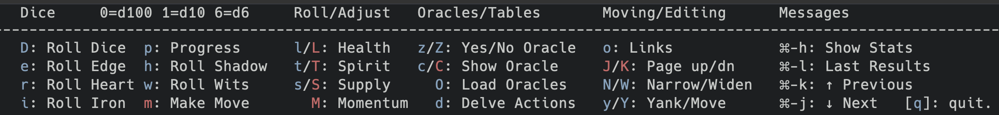
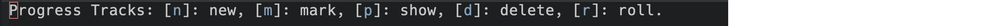
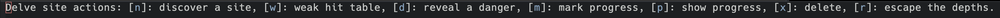
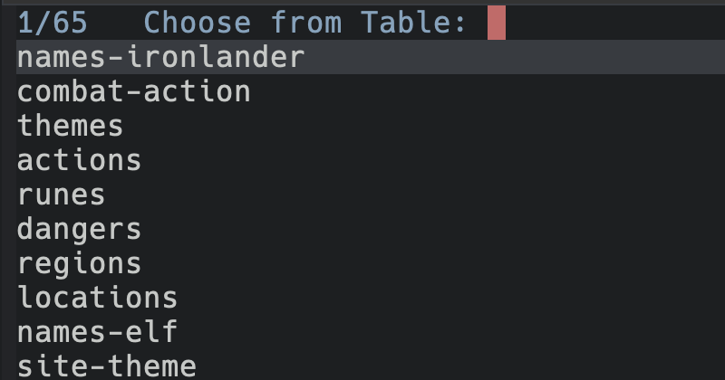
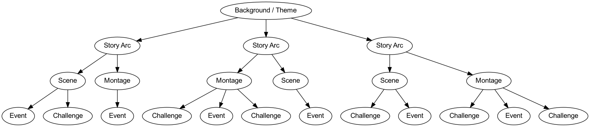
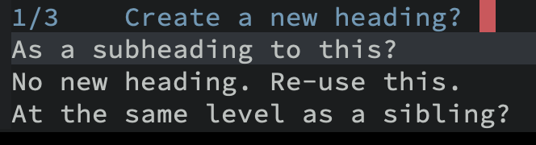
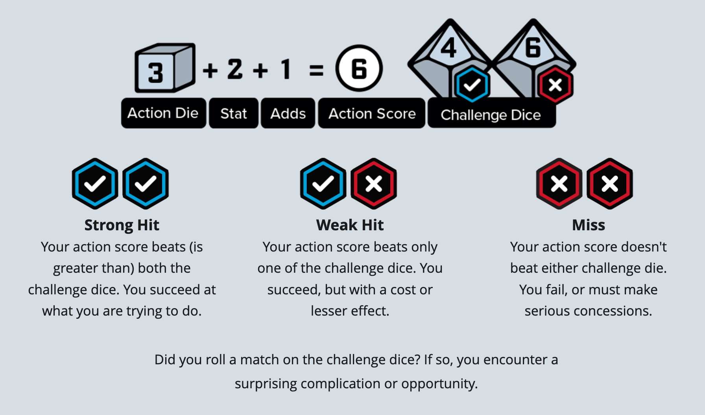
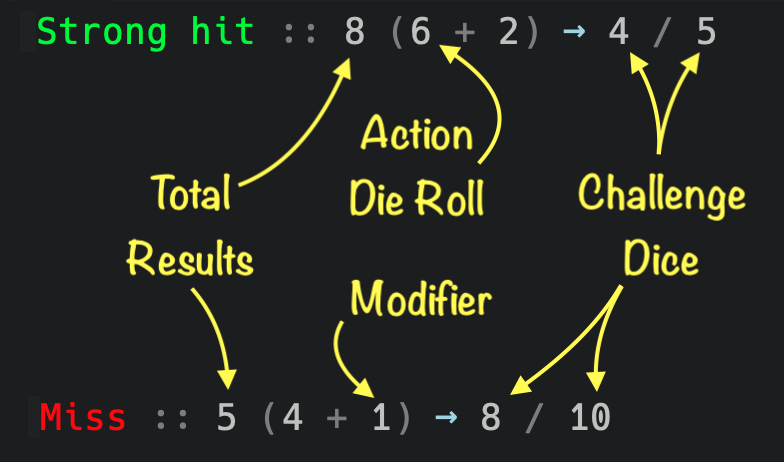
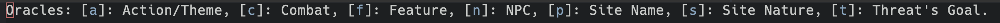

#+TITLE:  Ironsworn RPG Help System
#+AUTHOR: Howard X. Abrams
#+EMAIL:  howard.abrams@gmail.com
#+DATE:   2021-12-21 December
#+TAGS:   rpg
#+PROPERTY:    header-args:sh :tangle no
#+PROPERTY:    header-args:emacs-lisp  :tangle no
#+PROPERTY:    header-args   :results none   :eval no-export   :comments no

#+OPTIONS:     num:nil toc:nil todo:nil tasks:nil tags:nil date:nil
#+OPTIONS:     skip:nil author:nil email:nil creator:nil timestamp:nil
#+INFOJS_OPT:  view:nil toc:nil ltoc:t mouse:underline buttons:0 path:http://orgmode.org/org-info.js

While my original goal for creating my [[https://gitlab.com/howardabrams/emacs-rpgdm][rpgdm project]] for Emacs was to help running a role playing game using a laptop instead of a /Dungeon Master Screen/. However, once all my games moved online, having my notes in an org file next to all my friend's faces, was doubly helpful. However, what I used the most from this project was the random tables. Need a name? ~F6 c name~ ... What's the weather like? ~F6 c weather~ (and with completing helpers like [[https://github.com/raxod502/selectrum][selectrum]] and the like, I only needed to type ~we~).

However, the struggles for getting friends to play online proved as challenging as getting them around the table, so I started looking for [[https://www.dicebreaker.com/categories/roleplaying-game/how-to/how-to-play-tabletop-rpgs-by-yourself][solo rpg options]] and discovered [[https://www.ironswornrpg.com/][Ironsworn RPG]]. The bulk of the game is its /moves/ and its /oracles/ (random tables for /everything/). I easily copied sections of the [[https://docs.google.com/document/d/11ypqt6GfLuBhGDJuBGWKlHa-Ru48Tf3G_6zbrYKmXgY/edit#heading=h.xl9vk0d7wwn3][SRD]] into org files, [[file:tables][tables]].

After listening to the author, [[https://twitter.com/ShawnTomkin][Shawn Tomkin]], play the game in his podcast, [[https://ironsworn.podbean.com/][Ask the Oracle]], he used [[https://roll20.net][Roll20]]. The [[https://wiki.roll20.net/Ironsworn][character sheet]] was brilliant, as each move was /described/ along with being able to roll on them. While I love physically rolling dice, perhaps mimicking the approach in org files in Emacs for [[https://www.ironswornrpg.com/products-ironsworn][solo play]] may be ideal.

This is Brett Hutley's fork of Howard's project. The code lives in [[file:rpgdm-ironsworn.el][rpgdm-ironsworn.el]]; this document describes how to use it. (Earlier versions of this file were a literate program that tangled into the code. It no longer is.)

* Getting Started
Neither this, nor the [[https://github.com/bhutley/emacs-rpgdm][rpgdm project]] are in MELPA, so clone both repos and add them to your =load-path=. You also need the =dash=, =s=, =f= and =hydra= packages, which you can install from MELPA.

#+BEGIN_SRC emacs-lisp
  (add-to-list 'load-path (expand-file-name "~/src/rpg/emacs-rpgdm"))
  (add-to-list 'load-path (expand-file-name "~/src/rpg/emacs-ironsworn"))
#+END_SRC

Or use something like [[https://github.com/raxod502/straight.el][straight]]:

#+BEGIN_SRC emacs-lisp
  (straight-use-package
   '(rpgdm :type git :host github :repo "bhutley/emacs-rpgdm"))

  (straight-use-package
   '(rpgdm-ironsworn :type git :host github :repo "bhutley/emacs-ironsworn"))
#+END_SRC

If you use =straight=, set the =rpgdm-ironsworn-project= variable to the directory where you cloned the repo /before/ the package loads, as the code reads its tables, moves and assets from that directory:

#+BEGIN_SRC emacs-lisp
  (use-package rpgdm-ironsworn
    :straight (:local-repo "~/src/rpg/emacs-ironsworn")
    :init
    (setq rpgdm-ironsworn-project (expand-file-name "~/src/rpg/emacs-ironsworn/")))
#+END_SRC

Next, create an org file, and either turn on =rpgdm-mode= (a minor mode that binds ~F6~ to the main menu), or define a globally accessible shortcut:

#+BEGIN_SRC emacs-lisp
  (global-set-key (kbd "<f6>") 'hydra-rpgdm/body)
#+END_SRC

To turn the mode on automatically, add this to the end of your Ironsworn org files:

#+BEGIN_SRC org
# Local Variables:
# eval: (progn (require 'rpgdm-ironsworn) (rpgdm-mode))
# End:
#+END_SRC

Many of the move and asset files contain hyperlinks that call functions. To skip the confirmation prompt for each of these links, set [[help:org-link-elisp-skip-confirm-regexp][org-link-elisp-skip-confirm-regexp]]:

#+BEGIN_SRC emacs-lisp
  (setq org-link-elisp-skip-confirm-regexp (rx string-start (optional "(") "rpgdm-"
                                               (or "tables-" "ironsworn-")
                                               (one-or-more any)))
#+END_SRC

Finally, create your character: in an org file, type ~M-x rpgdm-ironsworn-new-character~ and answer the questions (see [[*Creating a Character][Creating a Character]]). Then press ~F6~ to bring up the menu:

#+ATTR_HTML: :width 1100px

The screenshot may lag behind the code, so here is what each key does:

  - Dice
    - ~0~, ~1~ and ~6~ roll a d100, d10 and d6.
    - ~D~ makes an /Ironsworn/ roll (a d6 action die against two d10 challenge dice), asking for the total modifier.
  - Rolling against your character (see [[*Rolling][Rolling]])
    - ~e~, ~r~, ~i~, ~h~ and ~w~ roll against your /edge/, /heart/, /iron/, /shadow/ and /wits/, asking for any extra modifier.
    - ~l~, ~t~ and ~s~ roll the challenge dice against your current /health/, /spirit/ and /supply/.
    - ~m~ makes a move: choose one, read its description in another window, and roll the stats it uses (see [[*Moves][Moves]]).
  - Adjusting your character (see [[*Adjusting Stats][Adjusting Stats]])
    - ~L~, ~T~ and ~S~ adjust your /health/, /spirit/ and /supply/.
    - ~M~ adjusts your /momentum/.
    - ~s-h~ (Super-h, ⌘-h on a Mac) shows your character's stats.
  - Sub-menus
    - ~p~ works with progress tracks (see [[*Progress Tracks][Progress Tracks]]):
      #+ATTR_HTML: :width 1100px
      
    - ~d~ works with Delve sites (see [[*Delve Sites][Delve Sites]]):
      #+ATTR_HTML: :width 1100px
      
    - ~a~ works with assets and /asset-related/ stats, like a companion's health, or the /Strength/ of the [[file:assets/paths/commander.org][Commander]]'s warband (see [[*Assets][Assets]]).
  - Oracles and tables (see [[*Oracles and Tables][Oracles and Tables]])
    - ~z~ asks the Oracle a yes/no question, choosing how likely it is.
    - ~Z~ asks a 50/50 question with a /yes, and/ or /no, but/ twist.
    - ~c~ rolls on one of the random tables (~C~ does the same, but keeps the menu open):
      #+ATTR_HTML: :width 1100px
      
    - ~O~ opens the oracles menu, which rolls on several tables together (see [[*Oracles and Tables][Oracles and Tables]]).
    - ~g~ loads more tables from a directory you choose.
  - Moving around and editing
    - ~o~ calls =ace-link= (if installed) to jump to an org link.
    - ~J~ / ~K~ scroll your org file while the menu is up.
    - ~N~ / ~W~ narrow to the current subtree, and widen again.
    - ~y~ yanks (pastes) the last table result or other message into your document.
    - ~Y~ yanks the results of the last move, along with the name of the move.
    - ~RET~ opens a new line below (needs =evil=).
  - Messages
    - ~s-l~ shows the last result again; ~s-k~ / ~s-j~ (or ~C-p~ / ~C-n~) step back and forward through earlier results.
  - ~q~ (or ~F6~) closes the menu.

** File Organization
I really didn’t want to dictate how Ironsworn notes should be organized, but I wanted the /progress tracks/ to be relevant. Sure, one can mark progress on one or more tracks, but I didn’t want see tracks that were old. I toyed with the idea of deleting, or just closing, old tracks, but I realized that progress tracks are really just arcs in the stories plot. Some of long, like a character /inciting vow/ and others are short, like a battle with a Cave Lion, but they are all nested in a hierarchical tree.

Let me explain with an illustration:
        #+BEGIN_SRC dot :file images/progress-tracks-tree.png :exports file :results file
          digraph G {
                bgcolor="transparent";
                node [fillcolor="white" style="filled" fontname="Arial"];

                Background [label="Background / Theme"]
                Arc1 [label="Story Arc"]
                Arc2 [label="Story Arc"]
                Arc3 [label="Story Arc"]
                Scene1 [label="Scene"]
                Scene2 [label="Montage"]
                Scene3 [label="Montage"]
                Scene4 [label="Scene"]
                Scene5 [label="Scene"]
                Scene6 [label="Montage"]
                Event1 [label="Event"]
                Event2 [label="Challenge"]
                Event3 [label="Event"]
                Event4 [label="Challenge"]
                Event5 [label="Event"]
                Event6 [label="Challenge"]
                Event7 [label="Event"]
                Event8 [label="Challenge"]
                Event9 [label="Event"]
                Event10 [label="Challenge"]
                Event11 [label="Event"]
                Event12 [label="Challenge"]

                Background -> Arc1;
                Background -> Arc2;
                Background -> Arc3;

                Arc1 -> Scene1;
                Arc1 -> Scene2;
                Arc2 -> Scene3;
                Arc2 -> Scene4;
                Arc3 -> Scene5;
                Arc3 -> Scene6;

                Scene1 -> Event1;
                Scene1 -> Event2;
                Scene2 -> Event3;
                Scene3 -> Event4;
                Scene3 -> Event5;
                Scene3 -> Event6;
                Scene4 -> Event7;
                Scene5 -> Event8;
                Scene5 -> Event9;
                Scene6 -> Event10;
                Scene6 -> Event11;
                Scene6 -> Event12;
              }
          #+END_SRC

A character or party has a theme or premise that drives the entire story, like Destroying the One Ring of Power or, teenagers solving mysteries with a talking dog. In Ironsworn, this is referred to as an /Epic Vow/. This epic story is broken into long-running arcs or character goals … perhaps they could be packaged into three books to make a Trilogy, or even seven books for each year in a school. These are the [[file:moves/quest/swear-an-iron-vow.org][various vows]], like the initial /Inciting Vow/.

These, in turn, are further divided into scenes like Journeying to Bree, Escaping Moria, or even each Saturday morning episode. In Ironsworn, these are moves like [[file:moves/adventure/undertake-a-journey.org][Undertake a Journey]] or [[file:moves/delve/delve-the-depths.org][Delve the Depths]]. And these segments can be punctuated by conflict and combat. These tracks are not concern with the length of a progress, as a battle with an Elder Beast will conclude before arriving at Grandma’s House, even those the Elder Beast was /formidable/ and the journey was merely /troublesome/.

Notice that this structure works well with the outline of a typical document, and by choosing this structure and tying a progress track to a header, completed tracks would disappear on their own, and I didn’t have to manage old tracks. As you call the progress functions, these prompt with a question:

** Character Sheets
A character sheet, for this project, is just an org mode file where you take notes, and =:PROPERTIES:= drawers contain the current stats for your character. While most of it is /whatever you like it to be/ ... you need to keep a few things in mind.

Stats and progress tracks are looked up from the heading at point and its ancestors, so if you narrow the buffer (~N~), anything stored above the narrowed subtree is hidden until you widen it again (~W~).
*** Character Attributes
Specify unchanging *Character Attributes* like =iron= and =shadow= in a drawer on the character's top heading (usually a level one heading), for instance:
#+BEGIN_EXAMPLE
,* The Adventures of Bred
:PROPERTIES:
:ironsworn-edge: 2
:ironsworn-heart: 1
:ironsworn-iron: 1
:ironsworn-shadow: 2
:ironsworn-wits: 3
:END:
#+END_EXAMPLE
The =rpgdm-ironsworn-new-character= command does this for you.
*** Character Stats
Set changeable *Character Stats* like =health= and =supply= under any heading. A lookup starts at the point (er, cursor) and works its way up the headings. This means that if you had =spirit= set to =5= at /level 1/, set to =3= at a /level 2/, and are now describing a battle with a Gaunt as a /level 3/ subheading where you haven't specified it ... your =spirit= at that point is =3=.

#+BEGIN_EXAMPLE
,* The Adventures of Bred
:PROPERTIES:
:ironsworn-spirit: 5
...
:END:
,** Journey to Stormlook
:PROPERTIES:
:ironsworn-spirit: 3
:END:
,*** Battle with a Gaunt
With the point here, Bred's spirit is 3.
,** Sojourn in Stormlook
However, at this level two heading, Bred's spirit is 5 (as it would read the level 1 setting).
#+END_EXAMPLE
Sibling headings, and headings below the point, are ignored. In other words, lookups use the tree structure of the org file, not what came earlier in the buffer.

Values can be negative, which matters for /momentum/ (for example, =:ironsworn-momentum: -2=).
*** Progress Track Properties
Set *Progress Tracks*, from Iron vows and bonds to tracking monstrous conflicts, /once/, at a particular heading. That progress is available to that heading and any of its subheadings.

Since /bonds/ and your character's overarching /epic vow/ should always be available, set these on the character's top heading.

Their properties are a bit peculiar, for instance:

#+BEGIN_EXAMPLE
:PROPERTIES:
:ironsworn-progress-b5f243e0: "Battle with Monstrosity" 8 16
:ironsworn-health: 3
:ironsworn-momentum: 3
:END:
#+END_EXAMPLE
In this example, along with changing both the /health/ and /momentum/ stats, we define a /progress/ track. It has a weird ID (that just has to be unique), the name of the track, the number of ticks to mark each time you mark progress, and the number of ticks marked so far (4 ticks per box, and 10 boxes per track, means 40 is the maximum).

The menus update all of these values, so you don't need to edit them by hand.

* Playing
** Creating a Character
In an org file, type ~M-x rpgdm-ironsworn-new-character~. It asks for:

  - The character's name. Leave it blank for a random Ironlander name.
  - Whether to enter statistics or choose assets first.
  - Your /edge/, /heart/, /iron/, /shadow/ and /wits/.
  - The title of your character's Epic vow.
  - Your assets: three random ones (no duplicates, at most one companion, and none of the assets you can't start with), or ones you choose.

It then appends a new top heading with your attributes, /health/, /spirit/ and /supply/ at 5, /momentum/ at 2, an epic progress track for your vow, a /Bonds/ track (marked once), and a /Bonds/ subheading listing your home settlement.
** Rolling
Every roll compares an /action die/ (a d6 plus your modifiers) against two d10 /challenge dice/:
#+ATTR_HTML: :width 800px

  - A *strong hit* is when your action die + modifiers is larger than both challenge dice.
  - A *weak hit* is when it is larger than /only one/ of the challenge dice.
  - A *miss* is when it is equal to or less than both challenge dice.

The result shows each number, so you can check the roll:
#+ATTR_HTML: :width 800px

If both challenge dice match, the result suggests a twist. When you roll against a stat (~e~, ~r~, ~i~, ~h~ and ~w~), the result also tells you when burning your momentum would turn a miss into a hit, or a weak hit into a strong hit.

The ~l~, ~t~ and ~s~ keys roll the challenge dice against your current /health/, /spirit/ or /supply/, with no action die.
** Adjusting Stats
~L~, ~T~, ~S~ and ~M~ (and adjusting an asset stat) ask for an adjustment:

| Input  | Effect                                                         |
|--------+----------------------------------------------------------------|
| ~+2~   | Increase by 2                                                  |
| ~-2~   | Decrease by 2                                                  |
| ~2~    | Decrease by 2 (but /momentum/ increases by 2)                  |
| ~=3~   | Set to 3                                                       |
| ~=-2~  | Set to −2                                                      |
| (none) | Decrease by 1 (but /momentum/ increases by 1)                  |
| other  | Reset to the default: 5 for health, spirit and supply, 2 for momentum |

Values stay within the rules: /health/, /spirit/ and /supply/ from 0 to 5, and /momentum/ from −6 to +10. To change these limits (for instance, a lower maximum momentum from debilities), set =rpgdm-ironsworn-stat-limits=. Asset stats have no limits.
** Moves
The [[file:moves][moves]] directory contains one org file for each move. Press ~m~ and choose a move; its description opens in another window, and you are asked to roll the stats it uses, for instance, choosing between /heart/ or /shadow/, or rolling your best of /heart/ and /health/. Moves that only start a progress track (like [[file:moves/quest/swear-an-iron-vow.org][Swear an Iron Vow]]) ask you to create one, and moves like [[file:moves/fate/pay-the-price.org][Pay the Price]] just show their description.

After a move, ~Y~ inserts a line with the move's name and its result into your notes.
** Progress Tracks
The ~p~ menu works with progress tracks:

  - ~n~ creates a new track. It asks for its name and challenge rank (troublesome, dangerous, formidable, extreme or epic), and whether to put it on a new sibling heading, a new subheading, or the current heading:
    
  - ~m~ marks progress on a track. Each mark adds the ticks for its rank, up to a full track of 10 boxes.
  - ~p~ shows a track's progress, as a score and a row of boxes.
  - ~r~ makes a progress roll: your progress score (completed boxes) against the challenge dice. Choose =<other>= to enter a score yourself.
  - ~x~ deletes a track.

Tracks are found on the current heading or its ancestors, so a track created for a battle disappears from the choices once you move on to the next scene.
** Delve Sites
The ~d~ menu supports the /Ironsworn: Delve/ expansion:

  - ~n~ discovers a site. Choose the site's theme and domain, accept or edit a randomly generated name, and choose its challenge rank. This adds a new subheading for the site, holding the site's progress track, theme and domain.
  - ~w~ rolls on the weak hit table for /Delve the Depths/, for the stat you used.
  - ~d~ reveals a danger. When the danger table says to check the theme or domain card, it rolls on the table for the site you are in, so use it with the point in the site's heading or one of its subheadings.
  - ~r~ makes the progress roll for /Locate Your Objective/, against the site's track (or any other track you choose).
  - ~m~, ~p~ and ~x~ mark, show and delete progress tracks, as in the ~p~ menu.

Each site keeps its own theme and domain, so you can have several sites in one file.
** Assets
The ~a~ menu works with assets:

  - ~A~ inserts the text of an asset from the [[file:assets][assets]] directory at point.
  - ~v~ shows an asset in another window.
  - ~n~ creates an /asset stat/, like a companion's health, stored on the character's top heading.
  - ~a~ adjusts an asset stat (see [[*Adjusting Stats][Adjusting Stats]]).
  - ~s~ shows an asset stat.
  - ~r~ rolls with an asset stat as your modifier.

Asset stats also appear when you show your character's stats with ~s-h~.
** Oracles and Tables
~z~ asks the Oracle a yes/no question. Choose the odds, and the result shows the d100 roll and the lowest roll that answers yes:

| Key | Odds           | Yes on |
|-----+----------------+--------|
| ~c~ | Almost Certain | 11+    |
| ~l~ | Likely         | 26+    |
| ~h~ | 50/50          | 51+    |
| ~u~ | Unlikely       | 76+    |
| ~n~ | Small Chance   | 91+    |

A /match/ (11, 22, 33 ... 99, or 100) is an extreme result, or a twist.

The [[file:tables][tables]] directory holds Shawn Tomkin's oracles, and the package loads them automatically. Press ~c~ to choose a table and roll on it. Many of the tables are designed to be rolled together, and these combinations are in the same list:

  - =action-and-theme= rolls on both the [[file:tables/action.org][action]] and [[file:tables/theme.org][theme]] tables, to kick-start your ideas.
  - =npc= rolls on all the character tables (name, role, goal, descriptor, activity and disposition).
  - =combat= combines the three combat tables.
  - =feature-aspect-and-focus= describes a feature of a site.
  - =location-and-descriptor= describes a waypoint.
  - =threat-goal= gives the goal for a kind of threat.
  - =site= and =site/name= describe and name a Delve site.

The same combinations are also in the oracles menu, on ~O~:
#+ATTR_HTML: :width 1200px

* Developer Notes
All the code is in [[file:rpgdm-ironsworn.el][rpgdm-ironsworn.el]], which builds on the [[https://github.com/bhutley/emacs-rpgdm][rpgdm]] project for dice, tables, messages and the base menu.

** Files
  - [[file:rpgdm-ironsworn.el][rpgdm-ironsworn.el]] :: All the code.
  - [[file:rpgdm-ironsworn-tests.el][rpgdm-ironsworn-tests.el]] :: The ERT tests.
  - [[file:tables][tables/]] :: Oracle tables, loaded with =rpgdm-tables-load=. A table's name is its path, for instance =site/name/place/barrow=.
  - [[file:moves][moves/]] :: One org file per move, in a directory per category.
  - [[file:assets][assets/]] :: One org file per asset, in a directory per asset type.
  - [[file:example.org][example.org]] :: An example character sheet.

** How State Is Stored
Everything about a character is an org property whose name starts with =ironsworn-=:

| Property                      | Example                         | Notes                                        |
|-------------------------------+---------------------------------+----------------------------------------------|
| =ironsworn-<stat>=            | =:ironsworn-momentum: -2=       | Attributes and stats; numbers may be negative |
| =ironsworn-progress-<id>=     | ="Slay the Wyrm" 8 16=          | Name, ticks per mark, ticks marked (max 40)  |
| =ironsworn-asset-<name>=      | =:ironsworn-asset-raven-health: 2= | Asset stats                               |
| =ironsworn-site-theme=, =ironsworn-site-domain= | =:ironsworn-site-domain: sea-cave= | On each Delve site's heading |

=rpgdm-ironsworn-current-character-state= collects these from the heading at point and each ancestor, with lower headings taking precedence, into a hash table.

** Move Properties
A move file's =move-stats= property says what to roll:

| Value                  | Meaning                                         |
|------------------------+-------------------------------------------------|
| =heart=                | Roll that stat                                  |
| =edge heart iron=      | Choose one of these stats to roll               |
| ~> heart health~       | Roll with the best of these stats               |
| =track=                | Create a progress track                         |
| =progress=             | Make a progress roll                            |
| track\vert{}heart      | Do each part in turn                            |
| (none)                 | Just show the move                              |

** Running the Tests
Run the tests in a clean Emacs, adding the =rpgdm= clone and the =dash=, =s=, =f=, =hydra= and =lv= packages to the load path:

#+BEGIN_SRC sh
  emacs -Q --batch \
        -L ../emacs-rpgdm \
        -L <dash dir> -L <s dir> -L <f dir> -L <hydra dir> -L <lv dir> \
        -l rpgdm-ironsworn.el -l rpgdm-ironsworn-tests.el \
        -f ert-run-tests-batch-and-exit
#+END_SRC
